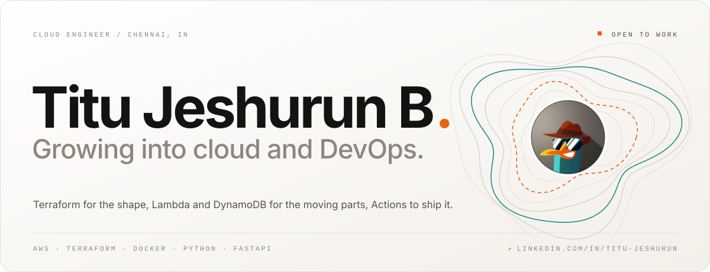
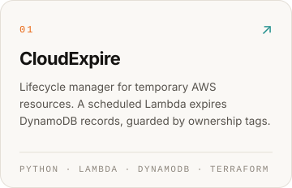
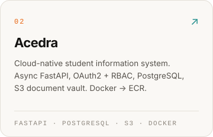
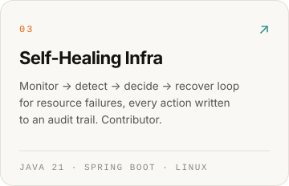

<picture>
  <source media="(prefers-color-scheme: dark)" srcset="assets/hero-dark.svg">
  
</picture>

 

  I'm Titu, a cloud engineer from Chennai. I work mostly on AWS, writing infrastructure in Terraform,
  packaging services with Docker and shipping them through GitHub Actions. I like systems that are small,
  well-documented and easy to rebuild, and I spend a lot of my time making sure the things I run are
  secure, cost-aware and tested on every push. Open to cloud, DevOps and platform roles.

 

<picture>
  <source media="(prefers-color-scheme: dark)" srcset="assets/label-work-dark.svg">
  
</picture>

  <a href="https://github.com/TituJesh/CloudExpire"><picture>
    <source media="(prefers-color-scheme: dark)" srcset="assets/card-cloudexpire-dark.svg">
    
  </picture></a>
  <a href="https://github.com/TituJesh/Acedra"><picture>
    <source media="(prefers-color-scheme: dark)" srcset="assets/card-acedra-dark.svg">
    
  </picture></a>
  <a href="https://github.com/DevForgeCore/Self-Healing-Cloud-Infrastructure"><picture>
    <source media="(prefers-color-scheme: dark)" srcset="assets/card-selfheal-dark.svg">
    
  </picture></a>

 

<picture>
  <source media="(prefers-color-scheme: dark)" srcset="assets/label-stack-dark.svg">
  
</picture>

<picture>
  <source media="(prefers-color-scheme: dark)" srcset="assets/stack-dark.svg">
  
</picture>

 

<picture>
  <source media="(prefers-color-scheme: dark)" srcset="assets/label-contact-dark.svg">
  
</picture>

  <a href="https://www.linkedin.com/in/titu-jeshurun">LinkedIn</a>
  &nbsp;&nbsp;·&nbsp;&nbsp;
  <a href="https://titujeshurun-portfolio.vercel.app">Portfolio</a>
  &nbsp;&nbsp;·&nbsp;&nbsp;
  <a href="https://github.com/TituJesh?tab=repositories">Repositories</a>

Chennai, India &nbsp;·&nbsp; open to cloud, DevOps and platform roles

